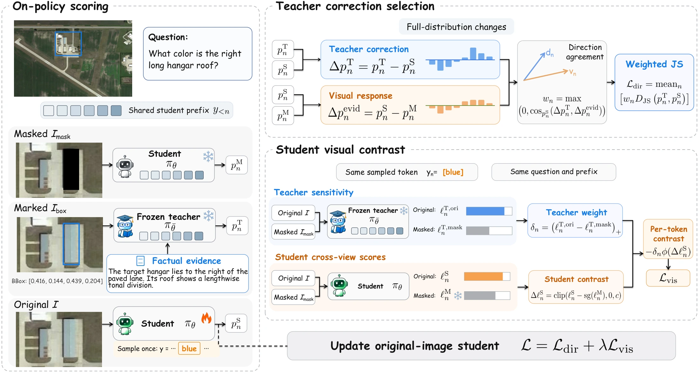
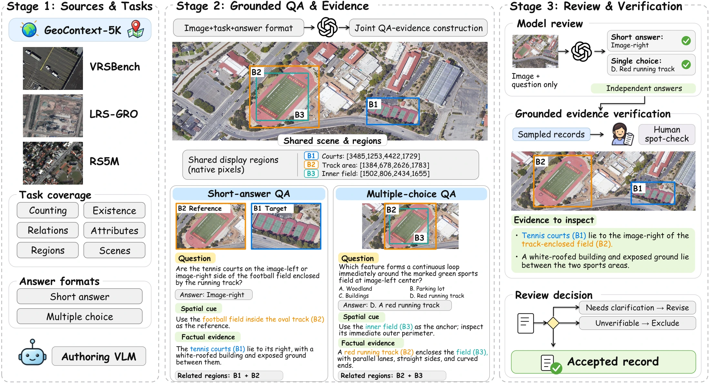
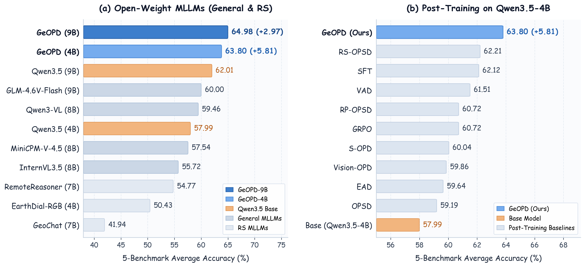

<div align="center">

<h1>Seeing the Right Context: Grounded On-Policy Distillation for Remote Sensing</h1>

[](#training-configurations)
[-0D9488?style=flat-square)](#geocontext-5k)
[](#release-roadmap)
[](#results)
[](LICENSE)

[Release Roadmap](#release-roadmap) · [Overview](#overview) · [GeoContext-5K](#geocontext-5k) · [Results](#results) · [Getting Started](#getting-started) · [Evaluation](#evaluation) · [Configurations](#training-configurations) · [Citation](#citation)

</div>

---

## Release Roadmap

- [x] Project overview, experimental configurations (`configs/`), and benchmark results
- [x] Five-benchmark remote sensing VQA evaluation & scoring toolkit (`eval/`) and sample schemas (`examples/`)
- [ ] Core **GeOPD** training framework
- [ ] Full **GeoContext-5K** training dataset on Hugging Face
- [ ] Pretrained **GeOPD-4B** and **GeOPD-9B** checkpoints on Hugging Face

## Overview

<table>
  <tr>
    <td><em>How can an MLLM internalize fine-grained remote sensing evidence together with its surrounding spatial references—without cropping away scene context or relying on multi-view tools at inference?</em></td>
  </tr>
</table>

<p align="center">
  <a href="assets/method.webp">
    
  </a>
</p>

**GeOPD** is a grounded on-policy distillation framework for remote sensing scene understanding. At inference time, the trained student answers directly from a single unmarked image and question.

- **Full-Scene Reference Preservation.** The frozen teacher sees the full image with target and reference boxes marked alongside an atomic visual fact. For counterfactual supervision, the masked student view fills only target pixels with the scene's mean RGB color while keeping surrounding landmarks and search boundaries unoccluded.
- **Directionally Weighted Distillation.** Along each student-sampled rollout prefix, GeOPD compares the teacher's update with the student's distributional shift when target evidence is restored, prioritizing teacher corrections that are visually grounded in the scene.
- **Teacher-Calibrated Visual Contrast.** The frozen teacher's log-probability drop under target masking weights a cross-view contrast objective that strengthens the student's score advantage on the original view, backpropagating solely through the original image branch.

## GeoContext-5K

<p align="center">
  <a href="assets/dataset.webp">
    
  </a>
</p>

**GeoContext-5K** explicitly disentangles queried target evidence from surrounding spatial references across **5,394 verified remote sensing VQA pairs** drawn from VRSBench, LRS-GRO, and RS5M.

| Property | Specification |
| :---: | :--- |
| **Scale & Formats** | 5,394 verified QA pairs (2,658 multiple-choice, 2,736 short-answer) |
| **Task Families (6)** | Counting · Existence & negation · Spatial relations · Attributes & comparisons · Regional extent & boundaries · Scenes & land cover |
| **Structured Annotations** | Spatial cue, atomic visual fact, and role-specific normalized `[x_min, y_min, x_max, y_max]` boxes (`target`, `reference`, `context`) |
| **Sample Records** | See [`examples/geocontext5k_samples.jsonl`](examples/geocontext5k_samples.jsonl) |

<details>
<summary><strong>Inspect a sample GeoContext-5K annotation</strong></summary>

```json
{
  "sample_id": "geocontext-sample-0001",
  "source": "VRSBench",
  "image": "images/VRSBench/01549_0000.png",
  "task_family": "spatial_and_relational",
  "answer_format": "short_answer",
  "question": "Is the airplane to the image-left or image-right of the dark vehicle on the vertical road just above the striped pedestrian crossing?",
  "answer": "Image-right",
  "spatial_cue": "Use the airplane within the curved landscaped island and the dark vehicle on the vertical road just above the striped pedestrian crossing.",
  "visual_fact": "The airplane is on the image-right side of the road. The dark vehicle sits on the road above the striped crossing, with a curb and landscaped strip separating it from the aircraft site.",
  "supporting_regions": [
    {"role": "target", "bbox_xyxy": [0.566, 0.299, 0.908, 0.713]},
    {"role": "reference", "bbox_xyxy": [0.412, 0.402, 0.443, 0.473]},
    {"role": "context", "bbox_xyxy": [0.367, 0.574, 0.443, 0.621]}
  ]
}
```

</details>

## Results

<p align="center">
  <a href="assets/results_bars.png">
    
  </a>
</p>

Across five remote sensing VQA benchmarks (equal-weight average, %), **GeOPD-4B** improves over Qwen3.5-4B by **+5.81** points and surpasses the Qwen3.5-9B base model by **+1.79** points, while **GeOPD-9B** reaches **64.98%** (**+2.97** over Qwen3.5-9B).

### Open-Weight Model Comparison

Comparison against open-weight general-purpose and remote sensing MLLMs. **Bold** and <u>underline</u> denote the best and second-best scores per column.

<table>
  <thead>
    <tr>
      <th align="center" scope="col">Model</th>
      <th align="center" scope="col">Params.</th>
      <th align="center" scope="col">CHOICE</th>
      <th align="center" scope="col">GEOBench-VLM</th>
      <th align="center" scope="col">OmniEarth</th>
      <th align="center" scope="col">HRVQA</th>
      <th align="center" scope="col">LHRS-Bench</th>
      <th align="center" scope="col">Avg.</th>
    </tr>
  </thead>
  <tbody>
    <tr><th colspan="8" align="center" scope="rowgroup">General models</th></tr>
    <tr>
      <td align="center">InternVL2.5</td>
      <td align="center">8B</td>
      <td align="center">71.79</td>
      <td align="center">45.66</td>
      <td align="center">48.03</td>
      <td align="center">28.55</td>
      <td align="center">71.16</td>
      <td align="center">53.04</td>
    </tr>
    <tr>
      <td align="center">InternVL3.5</td>
      <td align="center">8B</td>
      <td align="center">72.90</td>
      <td align="center">48.99</td>
      <td align="center">47.58</td>
      <td align="center">37.10</td>
      <td align="center">72.03</td>
      <td align="center">55.72</td>
    </tr>
    <tr>
      <td align="center">Qwen2.5-VL-Instruct</td>
      <td align="center">7B</td>
      <td align="center">75.09</td>
      <td align="center">48.43</td>
      <td align="center">48.13</td>
      <td align="center">41.10</td>
      <td align="center">69.57</td>
      <td align="center">56.46</td>
    </tr>
    <tr>
      <td align="center">MiniCPM-V-4.5</td>
      <td align="center">8B</td>
      <td align="center">76.56</td>
      <td align="center">50.36</td>
      <td align="center">50.24</td>
      <td align="center">37.20</td>
      <td align="center">73.33</td>
      <td align="center">57.54</td>
    </tr>
    <tr>
      <td align="center">MiMo-VL-RL</td>
      <td align="center">7B</td>
      <td align="center">76.24</td>
      <td align="center">46.25</td>
      <td align="center">46.75</td>
      <td align="center">44.80</td>
      <td align="center">70.58</td>
      <td align="center">56.92</td>
    </tr>
    <tr>
      <td align="center">GLM-4.6V-Flash</td>
      <td align="center">9B</td>
      <td align="center">76.85</td>
      <td align="center">50.89</td>
      <td align="center">55.83</td>
      <td align="center">42.80</td>
      <td align="center">73.62</td>
      <td align="center">60.00</td>
    </tr>
    <tr>
      <td align="center">ZwZ</td>
      <td align="center">8B</td>
      <td align="center">76.29</td>
      <td align="center">50.26</td>
      <td align="center">49.73</td>
      <td align="center">34.90</td>
      <td align="center">75.80</td>
      <td align="center">57.40</td>
    </tr>
    <tr>
      <td align="center">Qwen3-VL</td>
      <td align="center">8B</td>
      <td align="center">78.01</td>
      <td align="center">49.67</td>
      <td align="center">52.67</td>
      <td align="center">42.60</td>
      <td align="center">74.35</td>
      <td align="center">59.46</td>
    </tr>
    <tr>
      <td align="center">Qwen3.5</td>
      <td align="center">4B</td>
      <td align="center">78.52</td>
      <td align="center">48.89</td>
      <td align="center">48.47</td>
      <td align="center">38.55</td>
      <td align="center">75.51</td>
      <td align="center">57.99</td>
    </tr>
    <tr>
      <td align="center">Qwen3.5</td>
      <td align="center">9B</td>
      <td align="center"><u>81.54</u></td>
      <td align="center">51.39</td>
      <td align="center">55.08</td>
      <td align="center">42.75</td>
      <td align="center"><u>79.28</u></td>
      <td align="center">62.01</td>
    </tr>
  </tbody>
  <tbody>
    <tr><th colspan="8" align="center" scope="rowgroup">Remote sensing models</th></tr>
    <tr>
      <td align="center">GeoChat</td>
      <td align="center">7B</td>
      <td align="center">57.39</td>
      <td align="center">42.29</td>
      <td align="center">30.91</td>
      <td align="center">27.25</td>
      <td align="center">51.88</td>
      <td align="center">41.94</td>
    </tr>
    <tr>
      <td align="center">SkySenseGPT</td>
      <td align="center">7B</td>
      <td align="center">61.70</td>
      <td align="center">42.57</td>
      <td align="center">30.53</td>
      <td align="center">31.95</td>
      <td align="center">51.59</td>
      <td align="center">43.67</td>
    </tr>
    <tr>
      <td align="center">EarthMind</td>
      <td align="center">4B</td>
      <td align="center">73.03</td>
      <td align="center">44.69</td>
      <td align="center">39.89</td>
      <td align="center">19.60</td>
      <td align="center">70.58</td>
      <td align="center">49.56</td>
    </tr>
    <tr>
      <td align="center">VHM</td>
      <td align="center">7B</td>
      <td align="center">67.32</td>
      <td align="center">46.40</td>
      <td align="center">33.09</td>
      <td align="center">27.75</td>
      <td align="center">53.19</td>
      <td align="center">45.55</td>
    </tr>
    <tr>
      <td align="center">EarthDial-RGB</td>
      <td align="center">4B</td>
      <td align="center">67.13</td>
      <td align="center">50.02</td>
      <td align="center">36.07</td>
      <td align="center">35.15</td>
      <td align="center">63.77</td>
      <td align="center">50.43</td>
    </tr>
    <tr>
      <td align="center">RemoteReasoner</td>
      <td align="center">7B</td>
      <td align="center">74.26</td>
      <td align="center">48.18</td>
      <td align="center">47.16</td>
      <td align="center">37.15</td>
      <td align="center">67.10</td>
      <td align="center">54.77</td>
    </tr>
    <tr>
      <td align="center">TerraScope</td>
      <td align="center">8B</td>
      <td align="center">47.01</td>
      <td align="center">35.07</td>
      <td align="center">25.42</td>
      <td align="center">26.55</td>
      <td align="center">47.25</td>
      <td align="center">36.26</td>
    </tr>
  </tbody>
  <tbody>
    <tr>
      <td align="center"><strong>GeOPD</strong></td>
      <td align="center">4B</td>
      <td align="center">81.39</td>
      <td align="center"><strong>52.85</strong></td>
      <td align="center"><u>55.84</u></td>
      <td align="center"><u>49.20</u></td>
      <td align="center"><strong>79.71</strong></td>
      <td align="center"><u>63.80</u></td>
    </tr>
    <tr>
      <td align="center"><strong>GeOPD</strong></td>
      <td align="center">9B</td>
      <td align="center"><strong>83.59</strong></td>
      <td align="center"><u>52.41</u></td>
      <td align="center"><strong>58.07</strong></td>
      <td align="center"><strong>52.40</strong></td>
      <td align="center">78.41</td>
      <td align="center"><strong>64.98</strong></td>
    </tr>
  </tbody>
</table>

### 4B Post-Training Comparison

All post-training methods start from the same Qwen3.5-4B backbone and share the GeoContext-5K question budget.

| Method | CHOICE | GEOBench-VLM | OmniEarth | HRVQA | LHRS-Bench | Avg. |
| :---: | :---: | :---: | :---: | :---: | :---: | :---: |
| Base model | 78.52 | 48.89 | 48.47 | 38.55 | 75.51 | 57.99 |
| SFT | <u>81.15</u> | 50.36 | <u>53.85</u> | 46.95 | 78.26 | 62.12 |
| OPSD | 79.02 | 49.61 | 50.86 | 38.95 | 77.54 | 59.19 |
| GRPO | 80.55 | 47.49 | 52.47 | 46.30 | 76.81 | 60.72 |
| Vision-OPD | 79.86 | 49.86 | 51.54 | 39.80 | 78.26 | 59.86 |
| RP-OPSD | 80.20 | 47.96 | 53.76 | 42.40 | 79.28 | 60.72 |
| RS-OPSD | 80.25 | 50.05 | 53.09 | <u>48.40</u> | 79.28 | <u>62.21</u> |
| VAD | 80.26 | <u>50.58</u> | 53.39 | 43.05 | **80.29** | 61.51 |
| EAD | 79.93 | 49.58 | 51.43 | 39.15 | 78.12 | 59.64 |
| S-OPD | 79.80 | 49.80 | 51.97 | 40.10 | 78.55 | 60.04 |
| **GeOPD** | **81.39** | **52.85** | **55.84** | **49.20** | <u>79.71</u> | **63.80** |

## Getting Started

### Repository Structure

```text
GeOPD/
├── assets/                          # Overview, dataset, and benchmark figures
├── configs/                         # 4B and 9B experimental configurations
│   ├── geopd_4b.yaml
│   └── geopd_9b.yaml
├── eval/                            # Five-benchmark evaluation & scoring toolkit
│   ├── prompts.py                   # Prompt formatting and 1024px image loader
│   ├── scoring.py                   # MCQ, multi-select, and open-ended scoring
│   ├── validate_manifests.py        # Dry-run manifest & image path checker
│   ├── infer_vllm.py                # Resumable greedy vLLM evaluation runner
│   └── score_predictions.py         # Per-benchmark & 5-benchmark aggregator
├── examples/                        # Sample GeoContext-5K and manifest schemas
│   ├── geocontext5k_samples.jsonl
│   └── eval_manifest_samples.jsonl
├── requirements.txt
└── LICENSE
```

### Installation

```bash
git clone https://github.com/YeeCharm/GeOPD.git
cd GeOPD
python3.12 -m venv .venv
source .venv/bin/activate
python -m pip install -r requirements.txt
```

For GPU inference with `eval/infer_vllm.py`, install a CUDA-compatible PyTorch, `transformers`, and `vllm` runtime matching your hardware.

### Quick Check

Validate the bundled sample manifest schema on CPU:

```bash
python -m eval.validate_manifests \
  --manifest examples/eval_manifest_samples.jsonl \
  --skip-images
```

## Evaluation

### Benchmark Data Layout

Stage the five evaluation benchmarks under `evaluation/` using fixed question IDs and local image paths:

```text
evaluation/
├── manifests/
│   ├── CHOICE.jsonl                 # 9,407 questions
│   ├── GEOBench-VLM.jsonl           # 3,211 questions (single-image subset)
│   ├── OmniEarth.jsonl              # 5,656 questions
│   ├── HRVQA.jsonl                  # 2,000 questions (10 categories × 200)
│   ├── LHRS-Bench.jsonl             # 690 questions (original option order)
│   └── five_fixed.jsonl             # 20,964 questions combined
└── images/
    ├── CHOICE/
    ├── GEOBench-VLM/
    ├── OmniEarth/
    ├── HRVQA/
    └── LHRS-Bench/
```

Each manifest record contains `uid`, `dataset`, `task`, `format` (`mcq`, `multi`, or `open`), `images`, `question`, `options`, and `answer`.

### Evaluation Protocol

- **CHOICE & GEOBench-VLM**: Single-option accuracy (`GEOBench-VLM` uses the single-image subset).
- **OmniEarth**: Exact option-set match earns `1.0`; a nonempty strict subset of the reference option set on multi-select items earns `0.5`.
- **HRVQA**: Normalized open-ended answer matching across 10 categories (200 questions each; shape questions restricted to present targets).
- **LHRS-Bench**: Single-pass evaluation over all 690 questions in their original option order.
- **Inference settings**: Unmarked original images capped at 1024px long edge, greedy decoding (`temperature=0`), `enable_thinking=False`, and `max_tokens=128`.

### Running Evaluation

1. **Validate manifests and image paths (dry run):**

```bash
python -m eval.validate_manifests \
  --manifest evaluation/manifests/five_fixed.jsonl \
  --strict-counts
```

2. **Run resumable greedy vLLM inference:**

```bash
python -m eval.infer_vllm \
  --model-path Qwen/Qwen3.5-4B \
  --manifest evaluation/manifests/five_fixed.jsonl \
  --output outputs/qwen35_4b/predictions.jsonl \
  --tensor-parallel-size 1 \
  --batch-size 16
```

3. **Compute per-benchmark and five-benchmark average scores:**

```bash
python -m eval.score_predictions \
  --manifest evaluation/manifests/five_fixed.jsonl \
  --predictions outputs/qwen35_4b/predictions.jsonl \
  --output outputs/qwen35_4b/summary.json
```

## Training Configurations

| Backbone | Config | Training GPUs | Rollout TP | Updates | Selected Step |
| :---: | :---: | :---: | :---: | :---: | :---: |
| Qwen3.5-4B | [`geopd_4b.yaml`](configs/geopd_4b.yaml) | 4 | 1 | 56 | 42 |
| Qwen3.5-9B | [`geopd_9b.yaml`](configs/geopd_9b.yaml) | 4 | 2 | 56 | 49 |

Both runs use **5,394** GeoContext-5K training questions, **96** questions per update, **4** rollouts per question, a learning rate of `2e-6`, JS mixture `0.5` over top-100 candidates with a residual bucket, and visual contrast weight `λ = 0.02`. Checkpoints are evaluated on 256 development questions every 7 updates, breaking ties in favor of the earliest checkpoint.

## Acknowledgements

We thank the teams behind the following datasets, methods, and base models for making their resources publicly available:

### Datasets

- **VRSBench** — [Paper](https://arxiv.org/abs/2406.12384) · [Code](https://github.com/lx709/VRSBench) · [Dataset](https://huggingface.co/datasets/xiang709/VRSBench)
- **LRS-GRO (ZoomEarth)** — [Paper](https://arxiv.org/abs/2511.12267) · [Code](https://github.com/earth-insights/ZoomEarth) · [Dataset](https://huggingface.co/datasets/earth-insights/LRS-GRO)
- **RS5M** — [Paper](https://arxiv.org/abs/2306.11300) · [Code](https://github.com/om-ai-lab/RS5M) · [Dataset](https://huggingface.co/datasets/omlab/RS5M)

### Methods & Models

- **Vision-OPD** — [Paper](https://arxiv.org/abs/2605.18740) · [Code](https://github.com/VisionOPD/Vision-OPD)
- **Qwen3.5** — [Blog](https://qwen.ai/blog?id=qwen3.5) · [Models](https://huggingface.co/Qwen)

## Citation

If you find GeOPD or GeoContext-5K useful for your research, please consider citing:

```bibtex
@article{luo2026geopd,
  title={Seeing the Right Context: Grounded On-Policy Distillation for Remote Sensing},
  author={Luo, Yichang and Zhu, Hourun and Liu, Shixiong and Wei, Kan and Liang, Shi and Zhang, Yidan and Wang, Lei},
  year={2026}
}
```

## License

This project is released under the [Apache License 2.0](LICENSE).
